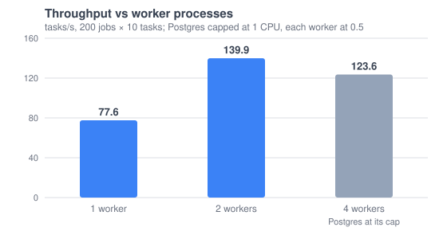

# Load test: throughput vs workers

**Result: after two fixes, a second worker process nearly doubles throughput (77.6 → 139.9 tasks/s). With four, Postgres hits its 1-CPU cap and throughput levels off at 123.6.** Before the fixes, a second worker made RelayForge slower.



## Round 2: after the fixes (CPU-capped)

The whole stack ran with hard Docker CPU caps, so it couldn't load the laptop: Postgres 1 CPU, the API 0.5, each worker 0.5, and Redis, Jaeger, Prometheus and Grafana 0.25 each. That's at most about 3.5 of 8 cores, and the busiest run used about 3.

| Worker processes | Tasks/s | Wall time | Job lock wait (avg) | Started event (avg) | Claim (avg) | CPU where it stalls |
|---|---|---|---|---|---|---|
| 1 | 77.6 | 25.8 s | 3.4 ms | 3.1 ms | 0.70 ms | worker at its 0.5 cap |
| 2 | 139.9 | 14.3 s | 7.3 ms | 4.9 ms | 1.01 ms | Postgres at its 1.0 cap |
| 4 | 123.6 | 16.2 s | 26.4 ms | 10.6 ms | 0.64 ms | Postgres at its 1.0 cap |

Load: `--jobs 200 --tasks 10 --duration 10`. Each job has a root task, 8 parallel middle tasks and a sink task, so 2,000 simulated tasks of 10 ms each.

## Round 1: before the fixes (uncapped)

| Worker processes | Tasks/s | Job lock wait (avg) | Claim (avg) |
|---|---|---|---|
| 1 | 143 | 1.1 ms | 3.4 ms |
| 2 | 98 | 11.5 ms | 11.4 ms |

Load: `--jobs 1000`, with no CPU caps, so its absolute numbers don't compare with round 2. What compares is the shape. Before the fixes, adding a worker cut throughput by a third. After them, it nearly doubles throughput, until the database runs out of CPU.

## What round 1 found, and what changed

1. **The started event held the job lock for a whole unit of work.** Every claim was followed by a full locked transaction: lock the job row, load the whole job and its tasks, save, advance, write the event, commit. All of that was just to number one "started" event. Siblings of one job queued behind each other. **Fix:** a start is now a single statement. It bumps the job's event number, inserts the outbox row and sends the NOTIFY, holding the row lock only for that one statement. Completions still take the full lock, because they change the DAG.
2. **The claim couldn't use an index.** It sorted all Ready rows by `priority + age / AgingSeconds`, which depends on `now()`. **Fix:** for any one query, `now()` is the same for every row, so that order equals sorting by the fixed per-row key `ReadyAt − Priority × AgingSeconds`. That key is stored as `ClaimOrder` when a task becomes Ready, and the partial index on Ready rows is keyed on it. Claims dropped to under 1 ms even with Postgres CPU-capped.
3. Two NOTIFYs per unit of work became one round trip.

## Where the ceiling is now

- **Postgres CPU.** At 2 and 4 workers it sits at its cap. Per task it currently runs: a claim, a started event, a locked completion (lock, load the task, load the attempt, save, load the job, save the outbox rows, notify, commit), a log flush, and the dispatcher's outbox read and mark.
- **Lock waits grow with workers** because a capped Postgres serves each locked unit more slowly. The 8 parallel middles of one job still complete through the same row. This DAG shape is the worst case for that.
- **Next steps, if needed:**
  - load only the dependents of the finished task in a completion, not the whole job;
  - flush logs less often under load;
  - batch claims (`LIMIT n` per round trip);
  - move Postgres onto its own machine.

## Reproduce (gently)

Apply CPU caps first, so the test can't take over the machine. Save this as `loadtest.override.yml` next to `docker-compose.yml`:

```yaml
services:
  postgres: { cpus: 1.0 }
  api:      { cpus: 0.5 }
  worker:   { cpus: 0.5 }
  redis:    { cpus: 0.25 }
  jaeger:   { cpus: 0.25 }
  prometheus: { cpus: 0.25 }
  grafana:  { cpus: 0.25 }
```

```bash
docker compose -f docker-compose.yml -f loadtest.override.yml --profile stack up -d --build --scale worker=1
docker exec relayforge-postgres psql -U postgres -d relayforge -c "CREATE EXTENSION IF NOT EXISTS pg_stat_statements"
dotnet run -c Release --project backend/tools/RelayForge.LoadTest -- --api http://localhost:8080 --jobs 200 --tasks 10 --duration 10
docker exec relayforge-postgres psql -U postgres -d relayforge -c \
  "SELECT calls, round(mean_exec_time::numeric,2) AS avg_ms, left(query, 80) FROM pg_stat_statements ORDER BY total_exec_time DESC LIMIT 5"
```

Scale with `--scale worker=N`. Each run of 2,000 tasks takes 15–30 s. Stop with `docker compose --profile stack stop`.
